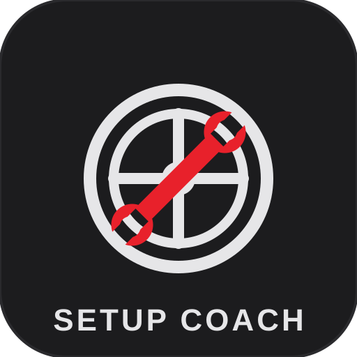

# R3E Setup-Coach

<p align="center"></p>

Analysiert **MoTeC-i2-Telemetrie (CSV-Export)** und leitet daraus **Setup-Empfehlungen für RaceRoom (R3E)** ab — z. B. zu Aero, Reifendruck, Bremsbalance, Fahrwerk und Fahrverhalten.

GUI-Abhängigkeit PySide6; Parser, Regelwerk und CLI kommen mit reiner Python-Standardbibliothek aus.

## Schnellstart

```bash
# Telemetrie in MoTeC i2 exportieren: Datei → Export → CSV (mit Kanal-Header)
python -m r3e_coach mein-log.csv
python -m r3e_coach mein-log.csv --lang en          # englische Ausgabe
python -m r3e_coach mein-log.csv --json             # maschinenlesbares JSON
python -m r3e_coach mein-log.csv --min-speed 60     # Schwelle für Fahrmanöver anpassen
```

Beispiel-Log liegt unter `examples/beispiel_motec_i2.csv`:

```bash
python -m r3e_coach examples/beispiel_motec_i2.csv
```

Als installierbares Paket steht außerdem der Befehl `r3e-coach` zur Verfügung:

```bash
pip install .
r3e-coach mein-log.csv
```

## GUI und Windows-Exe

Grafische Oberfläche (PySide6, dunkles Design im Stil von PitBoss R3E / R3E-Resultate):

```bash
r3e-coach gui          # oder: python r3e-coach-gui.py
```

Die Oberfläche hat drei Bereiche: **1) Bridge** (Exe-Pfad ist aus `.r3e-coach.json` vorbefüllt), **2) Telemetrie analysieren** (CSV per Dialog wählen, Bericht erscheint im Fenster; mit Strecke/Layout/Fahrzeug und „Analysieren und speichern" landet die Analyse in der Setup-Sammlung) und **3) Setups** (gespeicherte Setups mit Zielzeit und Detailansicht, Doppelklick öffnet den Eintrag, Zielzeit und Notizen sind dort editierbar).

## Setups verwalten (setups.json, R3E-Datenkonzept)

Der Coach ist Eigentümer von `setups.json` im Anwendungsordner (bei der Installation `%LOCALAPPDATA%\R3E-Setup-Coach\setups.json`). Primärschlüssel ist `track|layout|vehicle`; gespeichert werden Fundstellen der Analysen (immer Deutsch), Zielzeit, Notizen und eine Änderungshistorie. Schema-Version 1, atomar geschrieben, rückwärtskompatibel (unbekannte Felder bleiben beim Lesen erhalten).

```bash
# Analyse einer CSV unter einer Kombination speichern
r3e-coach analyze log.csv --track "Sachsenring" --vehicle "Audi R8 LMS Ultra 2016" --save
# Layout explizit (Standard: wie die Strecke)
r3e-coach analyze log.csv --track "Nordschleife" --layout "GP-Strecke" --vehicle "Audi R8" --save

# Setup-Sammlung auflisten bzw. einen Eintrag im Detail zeigen
r3e-coach setups
r3e-coach setups --key "Sachsenring|Sachsenring|Audi R8 LMS Ultra 2016"
r3e-coach setups --json
```

Strecken- und Fahrzeugnamen unverändert aus den RaceRoom-Ergebnisdaten übernehmen (keine eigenen Schreibvarianten), damit die Schlüssel über alle Apps matchen. In der Setups-Ansicht der GUI stehen Best- und Ø-Zeit je Kombination direkt neben der Zielzeit (farblich: grün = schneller als Ziel, rot = deutlich langsamer; Details per Tooltip). Spätere Versionen lesen zusätzlich den Verbrauch aus `fuel_history.json`.

## Rundenzeiten aus R3E-Resultate (results.db, nur lesend)

Der Coach liest Best- und Ø-Zeiten aus der Datenbank von **R3E-Resultate**: `Dokumente\RaceRoom Results Companion\results.db`. Die Datenbank wird ausschließlich im Nur-Lese-Modus geöffnet (`mode=ro`) — Eigentümerin bleibt die App R3E-Resultate. KI-Fahrer und ungültige Runden werden ausgeschlossen; fehlt die Datenbank, bleibt die Funktion ohne Fehler deaktiviert.

```bash
# Alle bekannten Strecke/Layout/Fahrzeug-Kombinationen auflisten
r3e-coach times
# Best- und Ø-Zeit für eine Kombination
r3e-coach times --track "Sachsenring" --vehicle "Audi R8 LMS Ultra 2016"
r3e-coach times --track "Nordschleife" --layout "GP-Strecke" --vehicle "Audi R8" --json
# Anderer Datenbank-Pfad
r3e-coach times --db "D:\Backups\results.db"
```

Als `.exe` bauen (auf dem Windows-PC einmalig ausführen):

```bat
scripts\build_exe.bat
```

Ergebnis: `dist\R3E-Setup-Coach\R3E-Setup-Coach.exe` (Fenstermodus; `onedir`-Build ohne Temp-Entpacken — weniger AV-False-Positives als `onefile`; optional `pip install .[exe]` vorher). Die Exe liest `.r3e-coach.json` aus dem Ordner, in dem sie gestartet wird.

### Exe über GitHub Actions bauen (ohne lokalen Build)

Der Workflow `.github/workflows/build-exe.yml` baut die App auf einem `windows-latest`-Runner — bei jedem Push/PR auf `main` und manuell über **Actions → build-exe → Run workflow**. Download: im fertigen Run unter **Artifacts** (`R3E-Setup-Coach-windows` → kompletter Ordner `R3E-Setup-Coach\` inkl. `R3E-Setup-Coach.exe` und `SHA256.txt`).

### Installer (fest installiert auf dem PC)

Neben dem zip gibt es pro Release einen **Windows-Installer** (`R3E-Setup-Coach-Setup.exe`, gebaut mit Inno Setup im `release.yml`-Workflow, Skript: `installer/setup.iss`):

- installiert nach `%LOCALAPPDATA%\R3E-Setup-Coach` (pro Benutzer, keine Admin-Rechte nötig — das Auto-Update darf später selbst schreiben)
- Startmenü- und optional Desktop-Verknüpfung, Deinstallations-Eintrag in den Windows-Einstellungen
- `.r3e-coach.json` wird mit in die App gepackt und liegt nach der Installation neben der Exe (Pfad bei Bedarf anpassen)

Lokal bauen: `scripts\build_exe.bat` (App) + Inno Setup lokal mit `iscc installer\setup.iss`.

### Releases & automatisches Update (wie bei PitBoss)

- Gepushter Tag `v*.*.*` (z. B. `git tag v0.2.0 && git push origin v0.2.0`) triggert `.github/workflows/release.yml`: baut die Exe auf `windows-latest` und veröffentlicht ein **GitHub-Release** mit `R3E-Setup-Coach-win.zip` + `SHA256.txt`
- Update-Prüfung in der App: `r3e-coach update` (oder `--check` nur prüfen) vergleicht die installierte Version mit `releases/latest`. Liegt ein neueres Release vor, wird das ZIP in einen Staging-Ordner `<App-Ordner>.update` entpackt; nach dem App-Ende übernimmt ein Tausch-Batch (`apply-update.cmd`) die neuen Dateien und startet die App neu. Geschützt und niemals überschrieben werden `.r3e-coach.json`, `setups.json` und `.update-exclude`
- Die GUI prüft beim Start automatisch, zeigt verfügbare Updates an und installiert sie per **„Update installieren"-Button** (Download im Hintergrund, danach Neustart der App; die aktive Version steht im Fenstertitel)

## Bridge-Exe automatisch starten (RaceRoom → MoTeC)

Damit MoTeC i2 überhaupt Daten von RaceRoom bekommt, läuft üblicherweise ein kleines Bridge-Exe. Der Coach kann es starten, überwachen und per **Strg+C kontrolliert beenden**:

```bash
r3e-coach bridge --exe "C:\Tools\R3E_MoTeC_Bridge.exe"
r3e-coach bridge --exe "C:\Tools\R3E_MoTeC_Bridge.exe" --args -- --port 5566
```

Damit der Pfad nicht jedes Mal eingegeben werden muss, legt eine Config an (wird automatisch aus dem aktuellen Verzeichnis geladen, wenn sie `.r3e-coach.json` heißt, sonst per `--config`):

```json
{
  "bridge_exe": "C:\\Tools\\R3E_MoTeC_Bridge.exe",
  "bridge_args": ["--port", "5566"],
  "bridge_cwd": "C:\\Tools"
}
```

```bash
r3e-coach bridge            # nutzt ./.r3e-coach.json
r3e-coach bridge --config "C:\Users\Du\r3e-coach.json"
```

Ablauf: `r3e-coach bridge` starten → RaceRoom starten → in MoTeC i2 loggen → fahren → Strg+C beendet die Bridge sauber. Danach die CSV exportieren und analysieren:

```bash
r3e-coach "C:\MoTeC\i2\Exports\mein-log.csv"
```

Hinweis: `.r3e-coach.json` enthält einen rechnerspezifischen Pfad (z. B. `S:\Downloads\R2M.exe`) — beim Klonen auf einem anderen PC entsprechend anpassen.

Tipp: Für ganz ohne Handgriffe kann die Bridge auch über einen Windows-Autostart-Eintrag oder den Taskplaner beim Login gestartet werden.

## Unterstützte Kanäle

Kanalnamen werden robust per Alias-Matching erkannt (Groß-/Kleinschreibung und Sonderzeichen egal). Sinnvoll sind u. a.:

| Zweck | typische MoTeC-Namen |
|---|---|
| Zeit / Rundenzeit | `Time`, `Lap Time` |
| Geschwindigkeit | `Speed`, `GPS Speed` |
| Gas / Bremse | `Throttle`, `Brake` |
| Lenkwinkel, Längs-/Querbeschleunigung | `Steering_Angle`, `G_Lat`, `G_Long` |
| Reifentemperatur je Ecke | `Tyre Temp FL/FR/RL/RR` (auch `_I/_M/_O` — werden gemittelt) |
| Bremsentemperatur je Ecke | `Brake Temp FL/FR/RL/RR` |
| Federweg je Ecke | `Susp Travel FL/FR/RL/RR`, `WheelY …` |

Fehlende Kanäle werden übersprungen — jede Regel arbeitet nur mit den vorhandenen Daten.

## Was analysiert wird

- **Reifen:** Temperatur-Balance vorne/hinten und links/rechts, absolutes Temperaturniveau (Ziel ~75–100 °C) → Druck-/Aero-Empfehlungen
- **Fahrverhalten:** Lenkwinkel und Lenkkorrekturen in Kurven → Unter-/Übersteuern → Aero-, Stabi-, Bremsbalance-Empfehlungen
- **Bremsen:** Bremsentemperaturen + mutmaßliche Blockierer → Bremsbalance
- **Fahrwerk:** minimaler Federweg auf Geraden → Durchschlagen → Höhe/Federn
- **Konsistenz:** Streuung zwischen Best- und Mittellap

## Wichtiger Hinweis

Die Schwellen sind **Heuristiken** aus Telemetrie-Erfahrung, keine Garantien. Coach-Ausgaben immer mit Streckenkenntnis und eigenem Gefühl abgleichen und Änderungen **eine nach der anderen** testen. Das Tool liest nur Daten — es verändert nichts am Fahrzeug.

## Entwicklung

```bash
pip install -e .[test]
pytest
```

App-Icon und Logo liegen als Geometrie in `tools/gen_icon.py` (reine Standardbibliothek) und werden im Build automatisch erzeugt (`python tools/gen_icon.py` schreibt `assets/app.ico` samt PNG); das Vektor-Logo steht unter `assets/logo.svg`.